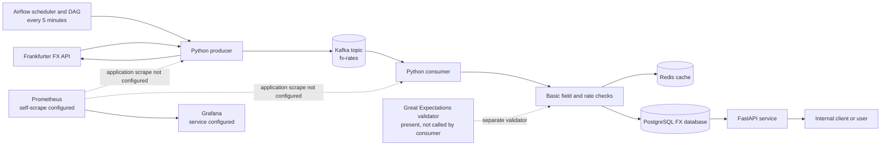

# FX Sync Engine

## Project documentation and onboarding guide

The FX Sync Engine is a Python project for collecting, checking, storing, and serving foreign-exchange (FX) rates. It is designed as a small but realistic example of a data platform: one part obtains data, another moves it through a message stream, and other parts store, validate, and expose it.

This guide starts with the business purpose and introduces technical terms as they are needed. It describes both the architecture the project is aiming for and what the repository currently implements. That distinction matters: configuration files and individual modules may exist before they are connected into a production-ready service.

> **Implementation note:** The repository contains a Frankfurter API client, a Kafka producer and consumer, basic validation, Redis writes, PostgreSQL access code, a FastAPI service, an Airflow ingestion DAG, and Docker Compose services for supporting infrastructure. Great Expectations has a validator module, but the Kafka consumer does not call it. Prometheus is currently configured to scrape Prometheus itself, and no application metrics endpoint or provisioned Grafana dashboard is present. The Compose file provisions PostgreSQL for Airflow metadata, not a separate FX application database. The related setup steps are explained below rather than presented as completed integrations.

## 1. Project overview

### The problem

Businesses that send or receive money across borders need to convert amounts between currencies. The conversion depends on an exchange rate: for example, how many units of one currency correspond to one unit of another. Rates change over time, and different systems may need the latest rate as well as a history of earlier rates.

Collecting rates by hand or having every application call an external provider directly creates operational problems. A provider can be temporarily unavailable, responses can be incomplete or malformed, and repeated requests can add latency and load. It can also be difficult to explain which rate a transaction used unless the organization keeps a record.

### Why build this project?

The project brings several common data-engineering and backend patterns together in one understandable system. It offers a practical way to explore how an external API, a streaming message broker, a database, a cache, an API service, and a scheduler can cooperate. These are transferable ideas used in payment platforms, pricing services, reporting systems, and other applications that depend on fresh external data.

### Business use case and expected outcomes

Imagine a cross-border payment service that needs a USD-to-EUR rate while quoting a payment. A scheduled process retrieves rates from an FX provider. The rates are sent through a message stream so that downstream processing is separated from collection. A consumer checks each message and stores accepted rates. An API gives internal applications a consistent place to retrieve rates.

The intended outcomes are:

- reduce repeated manual or application-by-application rate collection;
- make rates available in a consistent format;
- preserve a queryable record of received rates;
- reject obviously invalid values before they are relied on;
- make the latest values quick to retrieve through a cache;
- give operators visibility into pipeline health and execution.

These are platform goals, not a guarantee of financial-grade rate accuracy or regulatory suitability. A real payment system would also need explicit provider contracts, timestamps and freshness rules, security controls, reconciliation, alerting, operational ownership, and business approval of rate-selection policies.

## 2. Project goals

| Goal | In simple terms | Project role |
|---|---|---|
| Automated FX collection | Fetch rates without someone copying them manually. | The Frankfurter client retrieves the latest USD-based rates; Airflow has a five-minute publishing schedule. |
| Real-time-style processing | Move new data promptly instead of waiting for a large batch. | Kafka carries a message for each currency pair. The current schedule is periodic, not a guarantee of instantaneous delivery. |
| Data validation | Check that a rate has the fields and values the application expects. | The consumer uses required-field and positive-rate checks. A separate Great Expectations validator defines additional checks. |
| Data storage | Keep a durable record that can be queried later. | Repository code inserts rates into PostgreSQL; the SQL script defines the intended tables. |
| API exposure | Give other applications a stable way to read rates. | FastAPI provides root, health, and recent-rates endpoints. |
| Monitoring and observability | Help operators understand whether services are running and where problems occur. | Prometheus and Grafana containers are configured, but application-level metrics and dashboards still need integration. |
| Workflow orchestration | Schedule and manage recurring pipeline work. | An Airflow DAG invokes the rate publisher every five minutes. It currently schedules the publishing task, not the whole consumer-to-database lifecycle. |

## 3. Architecture overview

### Architecture diagram

The diagram separates the implemented path from observability and validation integrations that still need wiring. “Implemented” means relevant code or service configuration exists in this repository; it does not mean the system has been deployed or production-certified.



### The architecture in simple English

1. **Airflow** acts like a calendar and asks the producer to run on a schedule.
2. The **producer** requests the latest rates from Frankfurter and turns each currency pair into a small, structured message.
3. **Kafka** temporarily holds those messages in a named stream, or topic. This lets the producer and consumer work separately rather than needing to run as one program.
4. The **consumer** reads messages from the topic, checks required fields and a positive exchange rate, then writes the rate to Redis and PostgreSQL.
5. **Redis** is intended to make recent values quick to retrieve. In the current code, the consumer writes cache entries, while the API reads from PostgreSQL; the API does not yet read from Redis.
6. **FastAPI** offers HTTP endpoints to check service status and retrieve recent database rows.
7. **Prometheus** and **Grafana** are included as monitoring building blocks. The current Prometheus configuration only scrapes Prometheus itself; application metrics and dashboard provisioning are future integration work.

The `fx-rates` message currently includes provider, base currency, target currency, and exchange rate. PostgreSQL supplies `fetched_at` from a database default when the row is inserted. The message itself does not include the provider's observation timestamp, so a production system should define how rate time and ingestion time are represented.

## 4. Technology stack

| Technology | Purpose | Why it is used | Current repository use |
|---|---|---|---|
| Python | Core development | Readable language with a broad data and web ecosystem. | Producer, consumer, client, validators, database access, API, and DAG code. |
| Kafka | Messaging | Separates data collection from downstream processing and supports event streams. | Compose defines Kafka and Zookeeper; producer and consumer use the `fx-rates` topic. |
| PostgreSQL | Relational storage | Durable, queryable storage for structured records. | SQL schema and Python insert/query code exist. Configure an FX database separately from the Airflow metadata database. |
| Redis | Cache | Keeps frequently requested values in fast in-memory storage. | Compose defines Redis; the consumer writes pair keys to it. |
| FastAPI | HTTP API | Makes it straightforward to expose typed, high-performance Python web endpoints. | Root, health, and recent-rates endpoints are present. |
| Pandas | Data transformation | Convenient tabular representation for data checks and transformation. | The Great Expectations validator wraps one message in a DataFrame. |
| Great Expectations | Data quality | Expresses checks as expectations and reports whether a dataset meets them. | A separate validator checks null and range conditions; it is not currently called by the consumer. |
| Airflow | Workflow orchestration | Schedules and tracks recurring workflows. | The DAG invokes the producer every five minutes. |
| Prometheus | Metrics collection | Stores time-series measurements gathered from configured targets. | Container and configuration exist; current scrape target is Prometheus itself. |
| Grafana | Visualization | Displays metrics and other time-series data in dashboards. | Container exists; dashboard provisioning and application metrics are not configured here. |
| Docker | Containerization | Runs infrastructure components in repeatable containers. | Compose defines Kafka, Redis, Prometheus, Grafana, and Airflow-related services. |
| DBeaver | Database management | Provides a graphical way to connect to a database, run SQL, and inspect tables. | An optional desktop client for setup and exploration; it is not a project runtime dependency. |

## 5. Project journey

The milestones below describe a sensible progression for building and understanding the project. They distinguish working building blocks from integrations that still need additional configuration.

### Milestone 1 — Environment setup

A **virtual environment** is an isolated Python installation for one project. It helps prevent this project's package versions from interfering with other Python work. A typical setup is to create an environment, activate it, and install packages from `requirements.txt`. Keep credentials and machine-specific settings outside source control.

The repository gives the work a shared history: Git records changes, and a GitHub remote can make those changes reviewable and shareable. The project structure separates responsibilities such as producers, consumers, databases, and APIs rather than putting the whole pipeline in one script.

**Repository evidence:** Python package requirements, source folders, tests, SQL, Docker, Airflow DAGs, and documentation are present. The directory named `venv` is local environment state and should not be treated as application source.

### Milestone 2 — Database setup

PostgreSQL is the durable store: think of it as a set of structured tables that can be queried later. The schema in `sql/DDL.sql` defines an `fx_rates` table for rate history and a `pipeline_audit` table for process records. DBeaver can be used to connect, run the SQL, and inspect inserted rows.

The Python connection currently expects a PostgreSQL service on the local machine. The Compose PostgreSQL service is named `airflow-postgres` and is dedicated to Airflow metadata, so it is not automatically the FX database used by the application code. Before running ingestion, provision and configure a separate FX database consistently with the SQL and connection settings. Do not commit credentials to the repository.

### Milestone 3 — Caching layer

A **cache** is a fast, short-path store for values that are requested frequently. Instead of asking PostgreSQL for a popular currency pair each time, an application could read the latest pair from Redis.

Redis is defined as a Docker service and the cache helper stores values under keys such as `USD_EUR`. A small Redis set/get check helps establish that the service is reachable. The current ingestion code writes to Redis, but there is no cache read path or expiry policy in the API yet; those choices should be added when Redis is made part of serving behavior.

### Milestone 4 — Kafka integration

Kafka is a **message broker**: applications publish messages to a topic, and other applications read them independently. A topic is similar to a named channel for related events. This pattern is called **event streaming** because events can be produced and consumed continuously over time.

The Compose setup defines Kafka with Zookeeper. The producer publishes JSON messages to `fx-rates`; the consumer subscribes using a consumer group. For local host processes, the producer default uses `localhost:9092` and the consumer uses `localhost:29092`; Airflow containers are configured to use the internal broker address `fx-kafka:9092`. These addresses depend on where the process runs—container-to-container and host-to-container connections are not interchangeable.

### Milestone 5 — FX rate ingestion

The `FrankfurterClient` requests the provider's latest rates with USD as the base currency. The producer reads the returned base and rates, then publishes one message per target currency. It flushes the producer after sending messages so buffered records are pushed to Kafka.

This makes provider data available to downstream processing without requiring the API request and database insert to happen in the same process. The current example uses one provider and a fixed base currency; retries, provider failover, rate timestamps, and configurable currency selection are future hardening areas.

### Milestone 6 — Data persistence

The consumer reads a Kafka message, extracts its provider, currencies, and rate, runs the basic validator, writes the value to Redis, and inserts a row into PostgreSQL. The database insert commits the transaction so the row becomes durable.

At present, the application connection settings and the SQL's database-creation steps must be aligned manually. The Compose file does not create the FX application database. This milestone is only operational once PostgreSQL is available with the expected schema and the consumer can connect to it.

### Milestone 7 — Validation layer

**Data validation** means checking data before trusting or storing it. A missing currency code or a zero/negative rate can cause confusing results downstream.

The consumer calls `validate_rate`, which checks for four required fields, rejects a null exchange rate, and requires a positive rate. A separate Great Expectations module converts a message into a one-row Pandas DataFrame and defines non-null and range checks. That module is not currently wired into the consumer, so those Great Expectations rules should not be described as part of the live persistence path until it is integrated and its result is handled.

For production, validation should also consider supported currency codes, numeric type and finiteness, provider timestamps, staleness, duplicates, and reasonable limits appropriate to the pair and business context. A fixed universal range can reject legitimate rates or accept implausible ones.

### Milestone 8 — REST API development

An **API** is a documented way for one program to request data from another. A **REST API** commonly uses HTTP routes such as `/health` and `/rates`.

The FastAPI application includes a root endpoint, a health response, and a `/rates` endpoint that retrieves up to the latest 100 database rows. FastAPI also provides interactive API documentation when the application is running. To exercise the API, start the module with an ASGI server such as Uvicorn and request those routes. The API currently queries PostgreSQL directly; it does not use Redis or expose a per-currency lookup endpoint.

### Milestone 9 — Monitoring

**Metrics** are numeric measurements over time—for example, how many rates were processed or how long a request took. **Observability** combines signals such as metrics, logs, and traces to help explain what a system is doing and why a failure occurred.

Prometheus periodically scrapes configured endpoints and stores metrics; Grafana can display them as charts and dashboards. Both containers are present. The current Prometheus configuration scrapes its own service only, and the application does not currently expose Prometheus metrics. Consequently, application throughput, validation failures, API latency, and Kafka consumer lag are not yet visible in the supplied monitoring setup.

### Milestone 10 — Workflow automation

Airflow is a workflow scheduler. A **DAG** (directed acyclic graph) describes tasks and their order; Airflow schedules runs, records status, and provides logs.

The repository DAG named `fx_ingestion_dag` calls the producer every five minutes and disables historical catch-up. The Compose configuration defines Airflow webserver, scheduler, and a metadata database. This automates publishing, but the consumer is a separate long-running process and is not launched as a task by this DAG. A complete deployment needs an explicit plan for running and supervising that consumer, plus database and cache connectivity from the relevant containers.

## 6. Data flow walkthrough

Here is the business workflow, from provider to user. It describes the intended complete flow; notes indicate where current wiring differs.

1. **The FX provider publishes exchange rates.** In this project, the Frankfurter API is the external source requested by the client.
2. **The producer fetches data.** It calls the provider, reads the base currency and returned rates, and creates a message for each target currency.
3. **Kafka receives events.** Each JSON message is written to the `fx-rates` topic. Kafka decouples the fetch step from storage.
4. **The consumer processes messages.** It waits for events and reads them using its consumer group.
5. **Validation rules execute.** Required fields, non-null value, and positive value checks are applied by the consumer. Great Expectations checks exist separately but are not yet part of this live path.
6. **Data is stored in PostgreSQL.** Accepted rates are inserted as rows, with `fetched_at` populated by the table's default timestamp. The FX database must be created and configured separately from Airflow's metadata database.
7. **Latest values are cached in Redis.** The current consumer writes each pair to a Redis key. An API read-through or cache-first lookup is a future step; the current `/rates` endpoint reads PostgreSQL.
8. **FastAPI exposes APIs.** Internal clients can call `/health` or `/rates` over HTTP.
9. **Prometheus gathers metrics.** In a fully connected deployment it would scrape application endpoints. The supplied configuration currently scrapes Prometheus itself only.
10. **Grafana visualizes performance.** Dashboards can display the metrics collected by Prometheus. Dashboard configuration and application metrics remain to be added.
11. **Airflow automates execution.** Its DAG triggers publishing on a five-minute schedule. A separate operational mechanism must keep the Kafka consumer running.

## 7. Folder structure

The following is a simplified view of the repository's current layout. Some supporting folders and local runtime directories are omitted for clarity.

```text
fx-sync-engine/
├── airflow/
│   ├── dags/                 # Additional Airflow workspace files
│   ├── logs/                 # Airflow run logs
│   └── plugins/              # Airflow plugin extension point
├── configs/                  # Configuration area
├── dags/
│   └── fx_ingestion_dag.py   # Scheduled rate-publishing workflow
├── docker/
│   ├── airflow/              # Airflow-related container configuration
│   ├── grafana/              # Grafana configuration area
│   └── prometheus/           # Prometheus scrape configuration
├── docs/
│   ├── PROJECT_DOCUMENTATION.md
│   └── Project_Manual.docx   # Existing document
├── great_expectations/       # Great Expectations project assets
├── sql/
│   └── DDL.sql               # Database and table definitions
├── src/
│   ├── api/                  # FastAPI routes
│   ├── cache/                # Redis client and cache helper
│   ├── clients/              # External provider client
│   ├── consumers/            # Kafka message processing
│   ├── database/             # Connection, schema model, queries, inserts
│   ├── monitoring/           # Monitoring package area
│   ├── producers/            # Kafka event publishing
│   └── validators/           # Basic and Great Expectations checks
├── tests/                    # Test suite location
├── docker-compose.yml        # Local infrastructure services
├── Dockerfile.airflow        # Airflow image dependencies
├── requirements.txt          # Python package list
└── README.md                 # Short project entry point
```

The producer, consumer, database, cache, API, and validation folders each keep a distinct responsibility. `clients/` isolates the external provider interface, while `dags/` contains the workflow that schedules the producer. `sql/` makes database structure reviewable and repeatable. `docker/` holds service-specific configuration, and `docker-compose.yml` brings several supporting services together for local work.

## 8. Key learnings

- **Data engineering:** A pipeline is a sequence of collection, transformation, validation, and storage steps. Defining each step's inputs and outputs makes it easier to debug.
- **Event-driven architecture:** A producer can publish without knowing the consumer's internal details. Kafka holds events between the two and provides a useful boundary between responsibilities.
- **APIs:** A small HTTP interface gives other programs a stable contract for health checks and data retrieval, rather than making them connect directly to internal modules.
- **Caching:** Redis can reduce read latency and database traffic for frequently requested values. A cache needs freshness, expiry, and invalidation rules as well as writes.
- **Monitoring:** Services being present is not the same as being observable. Useful metrics must be exposed, scraped, and presented in actionable dashboards.
- **Containerization:** Docker Compose can make local infrastructure easier to start consistently, but service names, ports, networks, and configuration differ between the host and containers.
- **Data validation:** Checks should run before data is trusted, and a validation failure should have a clear operational outcome. Rules need to be appropriate to the real currency pair and business use.
- **Workflow scheduling:** Airflow manages when tasks run and records their outcomes. Long-running consumers and scheduled producer tasks have different lifecycle requirements.

## 9. Practical challenges and resolution approaches

The repository does not include an incident log that proves which setup issues occurred historically. The scenarios below are common challenges for this stack and explain practical ways to diagnose and resolve them without presenting them as confirmed past events.

| Challenge | Why it happens | Practical resolution |
|---|---|---|
| Docker setup issues | Containers can start in a different order than dependencies become ready; a running container is not always ready to accept connections. | Check service logs and health/readiness, validate port mappings, and retry dependent work only after the service is available. Start with one service at a time when isolating a failure. |
| Kafka connectivity | A broker advertises different addresses to host processes and other containers. | Match the client bootstrap address to its network location: host processes use the mapped host listener; containers use the Compose service name and internal listener. Confirm topic and broker reachability from the same environment as the client. |
| Database configuration | The FX application database and Airflow metadata database serve different purposes, and the supplied connection code expects local PostgreSQL. | Create the FX database and tables explicitly, configure the application to use that database, then test a connection before starting the consumer or API. Keep passwords outside source control. |
| Package installation restrictions | Network policies, proxy settings, or incompatible package versions can block installation. | Use the approved package index or proxy, install in an isolated virtual environment, and capture compatible dependencies in the manifest. Avoid repeatedly changing versions without checking the actual error. |
| Airflow DAG troubleshooting | Import errors, missing packages, incorrect mount paths, or unavailable services can make a DAG fail to load or run. | Inspect scheduler and webserver logs, verify that the DAG and source mounts are visible inside the container, test imports in the same Airflow image, then trigger a single run and inspect task logs. |
| Consumer debugging | A consumer may be connected to the wrong listener, reading an unexpected offset, or rejecting an event during validation or persistence. | Confirm the topic, bootstrap address, group ID, and offset behavior; inspect a sample message; then verify the database and Redis connections separately. Log actionable failure context without logging credentials. |

## 10. Achievements and completion status

The check marks below refer to repository building blocks, not to an independently verified production deployment. “Needs integration” highlights the difference between a module or container being present and the full capability being operational.

- ✅ **FX ingestion path:** Frankfurter client and producer publish rates to Kafka.
- ✅ **Kafka producer-consumer architecture:** Producer and consumer use the `fx-rates` topic.
- ✅ **Redis cache write:** The consumer stores currency-pair values in Redis; API cache reads and freshness policy need integration.
- ✅ **PostgreSQL persistence code:** Insert and query helpers and SQL schema are present; the FX database must be configured separately.
- ✅ **Basic data validation:** The consumer checks required fields and positive, non-null rate values.
- ⚠️ **Great Expectations:** A separate validator defines null and range expectations, but it is not called by the consumer.
- ✅ **FastAPI service:** Root, health, and recent-rates routes are defined; API deployment and database connectivity require setup.
- ✅ **Airflow automation:** A DAG schedules publishing every five minutes; consumer supervision is separate.
- ⚠️ **Prometheus monitoring:** Prometheus is configured, but currently scrapes itself rather than the application.
- ⚠️ **Grafana dashboards:** Grafana service is defined; dashboard and application-metric configuration are not included.
- ✅ **Dockerized supporting services:** Compose defines Kafka, Redis, Prometheus, Grafana, and Airflow-related services. It does not define the FX application database or API container.

## 11. How This Project Demonstrates Industry-Level Skills

### Data Engineering

The project demonstrates the shape of an ingestion pipeline: source data is acquired, represented as messages, checked, and persisted. It also introduces the operational concerns around schema consistency and data freshness.

### Backend Development

The FastAPI service exposes HTTP endpoints, and separate Python modules define provider access, persistence, caching, and message processing. This shows how backend responsibilities can be separated into components.

### Distributed Systems

Kafka, Redis, PostgreSQL, Airflow, and the API run as independently configured services. Their boundaries introduce real distributed-systems concerns such as networking, availability, retries, message handling, and service readiness.

### Cloud-Native Design

Docker Compose describes repeatable local services, and the application is split into components that could be deployed independently. A production cloud deployment would still require environment-based configuration, secrets management, authentication, scaling, and resilient infrastructure.

### Monitoring and Observability

Prometheus and Grafana are represented in the stack, providing a foundation for metrics collection and visualization. Completing the application instrumentation is an important next step before claiming full operational visibility.

### Workflow Automation

The Airflow DAG shows scheduled execution and gives a clear starting point for task-level logs and run history. The next design step is to define how all pipeline components—including the long-running consumer—are started and monitored.

### Production Readiness

The project surfaces production concerns in an approachable scope: validation, durable storage, caching, scheduling, and monitoring. It is best presented as an end-to-end learning prototype with concrete production-oriented components, not as a ready-to-use financial pricing service. Production readiness would require, at minimum, secure externalized configuration, connected monitoring, retries and failure handling, idempotent persistence, tests, deployment health checks, and documented freshness guarantees.

## 12. Executive summary

### What was built?

The FX Sync Engine is a Python-based foreign-exchange rate synchronization prototype. It retrieves current USD-based rates from the Frankfurter service, publishes one Kafka event per target currency, consumes those events, performs basic checks, writes values to Redis and PostgreSQL, and provides a FastAPI interface for service health and recent stored rates. An Airflow DAG schedules the publishing step. Docker Compose describes supporting services for Kafka, Redis, Prometheus, Grafana, and Airflow.

### Why was it built?

The project explores how to centralize the collection of frequently changing exchange-rate data. A shared ingestion path can reduce repeated provider calls, make downstream access more consistent, and preserve a queryable history. It also gives a learner or reviewer an example of how modern backend and data-engineering tools fit together around a practical business problem.

### How does it work?

Airflow periodically starts the producer. The producer calls the external FX API and publishes structured messages to Kafka. A separate consumer reads the messages, checks required fields and rate positivity, caches each pair in Redis, and inserts it into PostgreSQL. FastAPI exposes a health route and a recent-rates route backed by PostgreSQL. The repository also contains a Great Expectations validator and monitoring services, but those pieces are not fully connected: the consumer uses the basic validator, Prometheus currently scrapes only itself, and Grafana dashboards are not provisioned. The Airflow DAG schedules publishing; the consumer needs its own run and supervision mechanism.

### What business value does it provide?

The design provides a foundation for consistent, automated rate collection and shared access. Durable storage supports later inspection, Kafka separates collection from processing, and Redis provides a path to low-latency reads. With complete validation, freshness rules, monitoring, and operational controls, this pattern could support internal payment quoting or reporting services. Actual business use would require provider and compliance review and production hardening.

### What technologies were used?

The project uses Python, Kafka, PostgreSQL, Redis, FastAPI, Pandas, Great Expectations, Airflow, Prometheus, Grafana, and Docker. DBeaver can be used as an optional graphical database client.

### What skills were demonstrated?

The project demonstrates foundational data-engineering workflow design, event-driven communication, Python backend development, REST API design, relational persistence, caching, data validation, container-based local infrastructure, and scheduled workflow orchestration. It also helps identify the next steps toward production readiness: align service configuration, integrate Great Expectations, expose and scrape application metrics, define cache freshness, supervise the consumer, and strengthen reliability and security.
